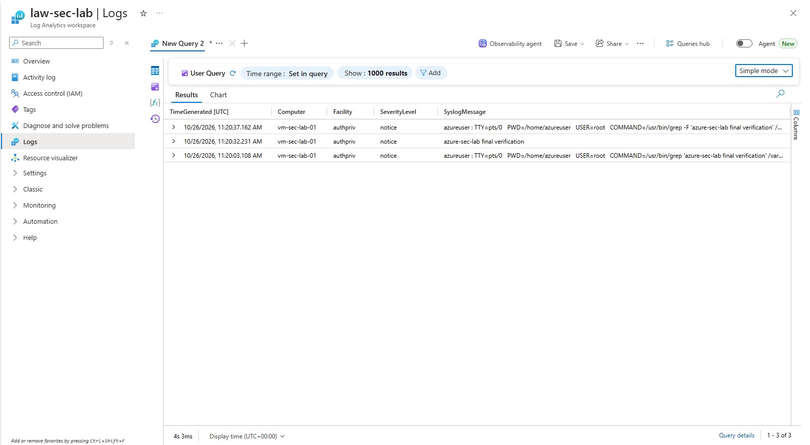

# Azure Secure Infrastructure Monitoring

A hands-on Azure cloud security and monitoring project demonstrating secure network configuration, Linux virtual machine deployment, centralized log collection, and Syslog investigation using Azure Monitor and Log Analytics.

## Project Overview

The objective of this project is to deploy a Linux workload in Azure, configure network security controls, collect Linux Syslog events, and verify log ingestion in a centralized Log Analytics workspace.

## Architecture

```text
Linux Virtual Machine
        |
        | Linux Syslog
        v
Azure Monitor Agent
        |
        v
Data Collection Rule (DCR)
        |
        v
Log Analytics Workspace
        |
        v
KQL Queries and Investigation
```

## Azure Resources

| Resource | Name |
|---|---|
| Resource Group | `rg-azure-sec-lab` |
| Virtual Network | `vnet-sec-lab` |
| Subnet | `snet-workload` |
| Network Security Group | `nsg-sec-lab` |
| Linux VM | `vm-sec-lab-01` |
| Log Analytics Workspace | `law-sec-lab` |
| Data Collection Rule | `dcr-sec-lab` |
| Monitoring Agent | Azure Monitor Agent |

## Security Configuration

- Deployed a Linux virtual machine in an Azure virtual network.
- Used a Network Security Group to control network traffic.
- Configured Azure Monitor Agent for Linux monitoring.
- Configured a Data Collection Rule to collect selected Syslog events.
- Used Log Analytics to investigate collected security-related logs.

**Security note:** Review the final NSG inbound rules before claiming that SSH access is restricted to a trusted IP address. Never publish private keys, credentials, or sensitive subscription details.

## Syslog Collection and Validation

A test event was generated on the Linux VM:

```bash
logger -p authpriv.notice "azure-sec-lab final verification"
```

The event was verified locally in `/var/log/auth.log` and subsequently appeared in the Log Analytics `Syslog` query results.

### KQL Query

```kusto
Syslog
| where TimeGenerated > ago(24h)
| where SyslogMessage contains "azure-sec-lab final verification"
| project TimeGenerated, Computer, Facility, SeverityLevel, SyslogMessage
| order by TimeGenerated desc
```

### Verified Result

- **Computer:** `vm-sec-lab-01`
- **Facility:** `authpriv`
- **Severity:** `notice`
- **Test message:** `azure-sec-lab final verification`

This confirms that the test Syslog event reached the Log Analytics workspace.

## Screenshots

Project evidence is maintained in the [`screenshots/`](screenshots/) directory.

<!-- Add the image below after uploading screenshots/syslog-ingestion.png -->


Additional evidence can include the Azure Monitor Agent status, DCR-to-VM association, Log Analytics workspace, and final NSG inbound rules.

## Troubleshooting Notes

During validation, the test message was present in the Linux authentication log before successful appearance in Log Analytics. This helped distinguish local logging from centralized ingestion.

Useful checks:

```bash
sudo grep -F "azure-sec-lab final verification" /var/log/auth.log
```

Review the Data Collection Rule, VM association, agent status, selected facilities and severity levels if future events do not appear.

## Cleanup and Cost Management

Azure virtual machines, disks, public IP addresses, and monitoring services may incur charges.

When the lab is no longer needed, review the resources in `rg-azure-sec-lab`. If you want to remove the entire lab, delete the resource group only after confirming that it contains no resources you need.

## Skills Demonstrated

- Microsoft Azure infrastructure
- Virtual networks and network security groups
- Linux administration and Syslog
- Azure Monitor Agent
- Data Collection Rules
- Log Analytics and Kusto Query Language (KQL)
- Basic cloud security monitoring and troubleshooting

## Project Status

**Syslog ingestion verified.** Final security review, evidence completeness, and cost cleanup should be checked before treating the entire project as fully finalized.
